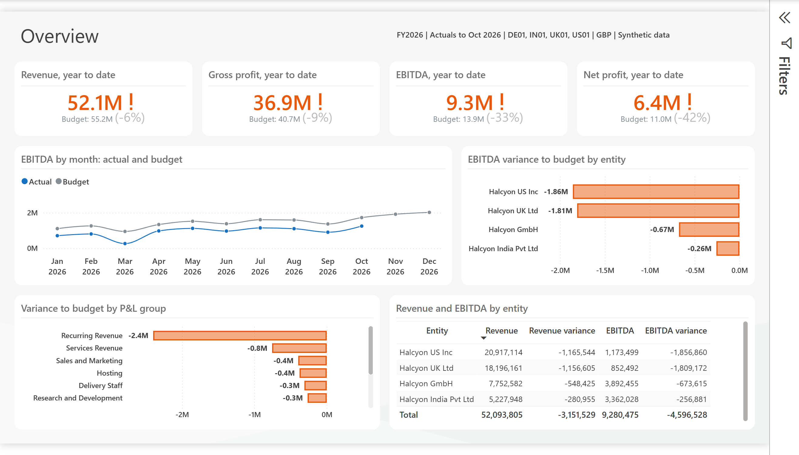
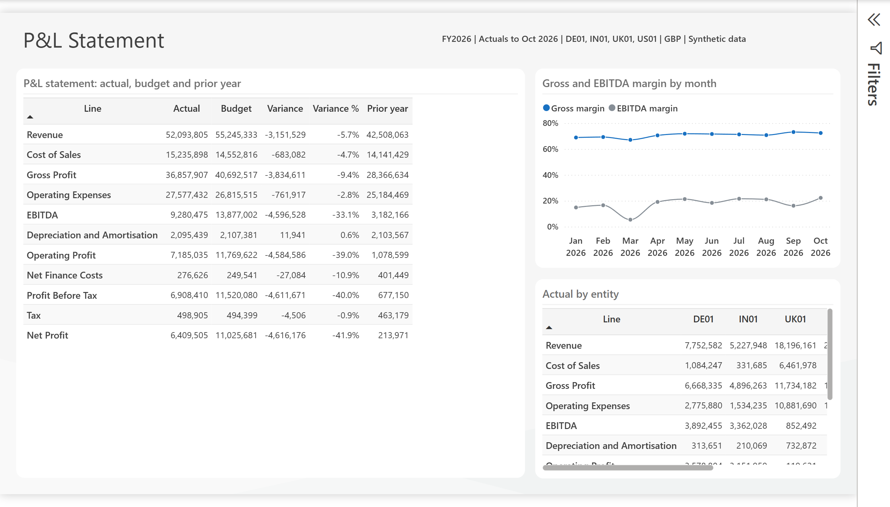
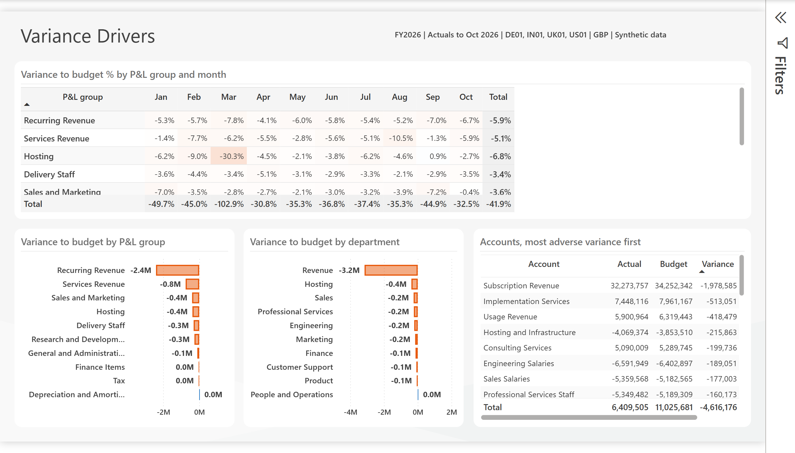
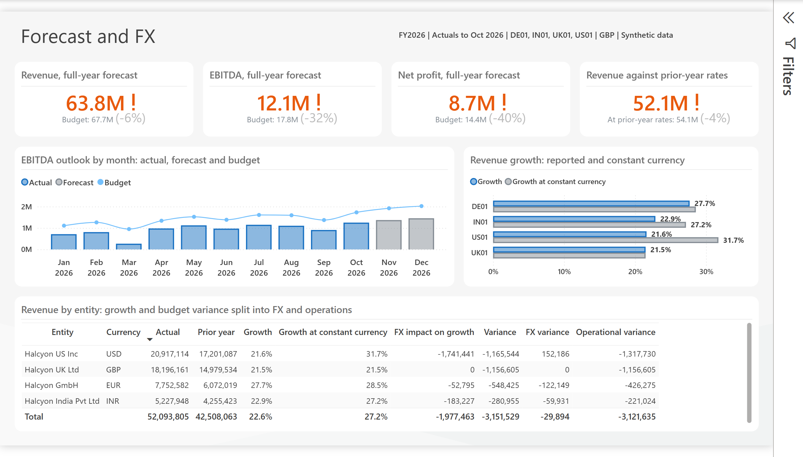
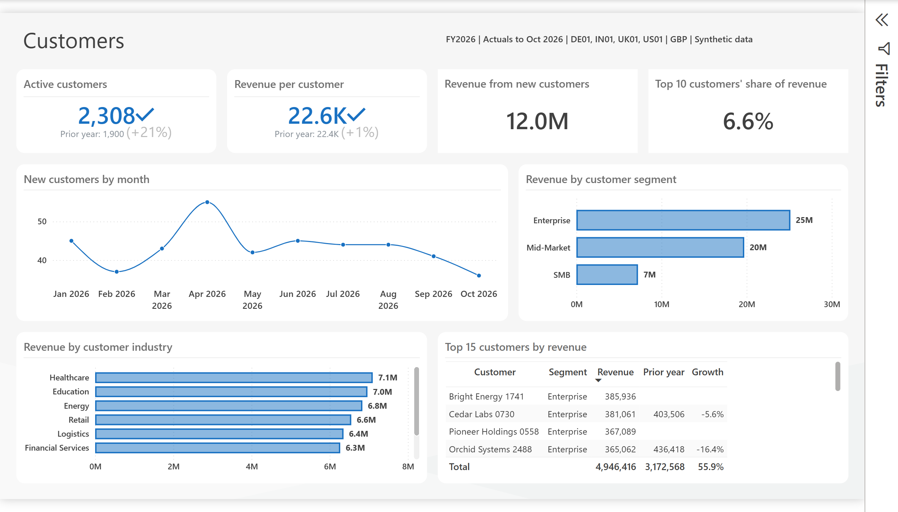
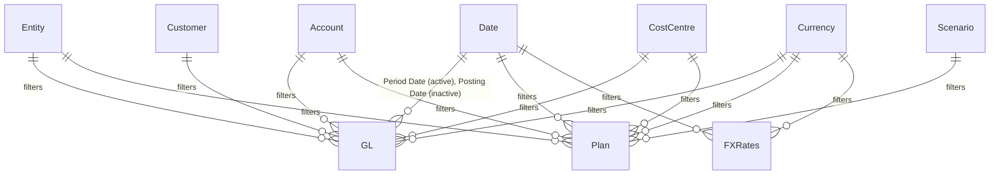
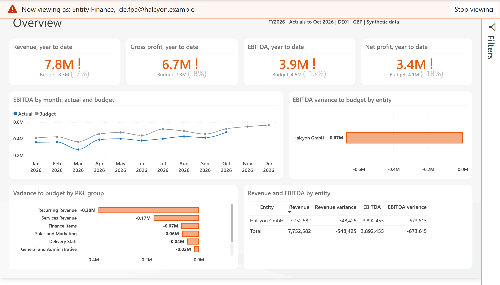

# Halcyon FP&A: a month-end P&L review in Power BI

A Power BI project that replaces a spreadsheet-based month-end review for a four-entity software group. It gives finance one
P&L in one currency, with budget, forecast, prior year and constant-currency views, and it keeps each entity's team inside
its own numbers.

It is built as a PBIP project (a TMDL semantic model and a PBIR report), so every measure, relationship and visual is plain
text under version control.

**All data is synthetic.** "Halcyon Group", its customers, its people and every figure in this repository are fictional and
generated by a script. Nothing here describes a real company. I chose synthetic data so the whole project, including the
ledger, can be public.



*Overview page, FY2026 to October. Synthetic data.*

## Contents

- [The problem](#the-problem)
- [The solution in five pages](#the-solution-in-five-pages)
- [What the report tells you](#what-the-report-tells-you)
- [The model](#the-model)
- [DAX worth reading](#dax-worth-reading)
- [Row-level security](#row-level-security)
- [Performance](#performance)
- [How I know the numbers are right](#how-i-know-the-numbers-are-right)
- [What is not verified](#what-is-not-verified)
- [Run it yourself](#run-it-yourself)
- [Repository layout](#repository-layout)
- [How it was built](#how-it-was-built)

## The problem

Halcyon Group sells software and services through four legal entities: the UK, the US, Germany and India. Each entity keeps
its ledger in its own currency. The group reports in GBP.

Every month the finance team has to answer the same questions, and in a spreadsheet process each one is slow or unreliable:

1. **There is no single P&L.** Four ledgers in four currencies have to be converted and stacked by hand before anyone can read a group number.
2. **Variance signs are a trap.** In a ledger, revenue is a credit and cost is a debit. "Actual minus budget" is good news on a revenue line and bad news on a cost line, and subtotals such as gross profit and EBITDA mix both.
3. **Exchange rates hide real performance.** When the dollar moves, US revenue in GBP moves with it. Nobody can say how much of a variance is trading and how much is currency.
4. **The forecast does not tie to the actuals.** The year-end outlook lives in a separate file, with its own rates, and drifts away from the closed months.
5. **Prior-year comparisons are unfair mid-year.** Ten months of this year get compared with twelve months of last year.
6. **Entity teams must not see each other's numbers,** and that includes customer names, not only totals.

The brief I set myself: one model that answers all six, with every number checked against an independent calculation, and
honest notes on what was not checked.

## The solution in five pages

Each page answers one question. Blue means favourable and orange means adverse on every page, for revenue and for costs
alike, so a reader never has to work out which way a variance points. The pair was chosen so that readers with red-green
colour blindness can tell them apart. The line at the top right of each page states the year, the last closed month, the
entities in scope and the currency, and that the data is synthetic.

### 1. Overview: are we on track against budget?

Four headline numbers against budget, the monthly EBITDA trend, and where the gap comes from by entity and by P&L group.


### 2. P&L Statement: what does the P&L look like line by line?

A proper statement from revenue to net profit with subtotals, showing actual, budget, variance and prior year side by side.
Costs are shown as positive amounts, the way finance reads them, while the variance column stays favourable-positive on every line.



### 3. Variance Drivers: which lines drive the gap, and when?

The heat matrix shows variance to budget by P&L group and month. A single dark cell, Hosting in March, is the kind of thing
this page exists to surface. Below it, the same variance by group, by department and by account.



### 4. Forecast and FX: where will the year land, and how much is currency?

The full-year forecast against budget, the monthly outlook (closed months as actuals, open months as forecast), and revenue
growth reported against growth at constant currency. The table at the bottom splits each entity's growth and budget variance
into a currency part and an operational part.



### 5. Customers: who is the revenue coming from?

Active customers and revenue per customer against the prior year, revenue from new customers, concentration in the ten
largest customers, and revenue by segment and industry.



## What the report tells you

These are the findings a reviewer would take from the FY2026 view (January to October actuals). All figures are synthetic GBP.
The generator plants a small number of stories in the data so that the report has something real to find; the report finds them.

| Finding | Evidence on the pages |
|---|---|
| Revenue is running 5.7% behind budget, and it has been behind every year. The budget is optimistic, not the business weak. | Revenue 52.1M against a budget of 55.2M. Revenue variance to budget is negative in 2024, 2025 and 2026 by a similar margin, while revenue itself grew 22.6% on the prior year. |
| EBITDA is 33% behind budget, and two entities account for most of it. | EBITDA 9.3M against 13.9M. The US and UK entities are each about 1.8M behind; Germany and India together are under 1M behind. |
| One cost spike stands out: hosting in March. | Hosting ran 30.3% over budget in March 2026, against single digits in every other month. It is a large third-party licence renewal, visible on the Variance Drivers heat matrix. |
| The dollar is flattering nobody: currency took almost 2M off reported revenue growth. | Group revenue grew 22.6% as reported and 27.2% at constant currency. For the US entity the gap is wider: 21.6% reported against 31.7% at constant currency, an FX effect of -1.74M. |
| Against budget, currency is not the story. | The 2026 budget rate was set after the dollar fell, so the FX part of the revenue variance to budget is only -0.03M of -3.15M. Almost all of the gap is operational. |
| The year is forecast to land well short of budget on profit. | Full-year EBITDA forecast 12.1M against a budget of 17.8M. Revenue forecast 63.8M against 67.7M. |
| The customer base is broad. | 2,308 active customers, up 21% on the prior year. The ten largest account for 6.6% of revenue. |

The fifth row is the one I would point a reviewer to. A model with only one kind of constant-currency view would have missed
it: the dollar's fall shows up year on year but not against budget, because of when the budget rate was fixed. The model
carries both views for that reason.

## The model

A star schema: two fact tables at different grains, a small rate table, and conformed dimensions. Every relationship is
many-to-one and single direction. There are no bi-directional relationships.



| Table | Rows | Grain and role |
|---|---:|---|
| `GL` | 307,697 | One ledger line, P&L accounts only, in local currency |
| `Plan` | 4,992 | Month by scenario by entity by account by cost centre. Budget for 2024 to 2026, forecast for 2026 |
| `FX Rates` | 144 | Month by currency: average, budget, forecast and prior-year rates to GBP |
| `Date` | 1,096 | One row per day, 2024 to 2026, marked as the date table |
| `Account` | 30 | Chart of accounts with a two-level P&L grouping |
| `Entity`, `Cost Centre`, `Customer` | 4, 31, 2,501 | Dimensions. `Customer` includes a "No customer" row for non-revenue lines |
| `Currency`, `Scenario` | 4, 3 | Small hidden dimensions that connect facts to rates and pick the plan scenario |
| `P&L Line` | 11 | Disconnected layout table for the statement, including subtotal rows |
| `User Entity Map` | 12 | Disconnected lookup for row-level security |

Design decisions that shaped everything else:

- **One sign convention.** The ledger is debit-positive, so revenue is stored negative. The model exposes `Actual`, `Budget`
  and `Forecast` in profit-impact sign: revenue positive, costs negative. They add up at any level (all accounts together are
  net profit), and a positive variance is favourable on every line. The statement page flips costs back to positive for display only.
- **The accounting period, not the posting date.** About 1.5% of ledger lines are late adjustments posted in the month after
  their period. Reports run on the period. The posting date is kept on an inactive relationship for the one measure that needs it.
- **Currency conversion in DAX, not in stored columns.** The model needs four rate sets. Storing a GBP column for each would
  quadruple the amount columns. Converting at month by currency grain costs tens of milliseconds at most. I measured this
  instead of assuming it; see [Performance](#performance).
- **The forecast rate is derived, not read.** The source rate file contains simulated rates for the two months that have not
  closed. The forecast must not use them: it converts at the average rate up to the last closed month and holds that rate flat.
  This was not in the data documentation. I found it by reading the generator, and I recorded it in `docs/data-dictionary.md`.

The model has 75 measures, each with a description, a display folder and a format string. `docs/data-dictionary.md`
describes the source data, its known limits and the stories planted in it.

## DAX worth reading

Four excerpts, each with the reason it is written the way it is. They are copied from
`Halcyon FPA.SemanticModel/definition/tables/_Measures.tmdl` and the role files.

**Currency conversion at month by currency grain.** Iterating ledger lines would be slow and iterating nothing would be wrong.
The rate changes only by month and currency, so that is the grain to iterate: at most 144 combinations however large the ledger gets.

```dax
Actual Ledger GBP =
SUMX (
    SUMMARIZE ( 'GL', 'Date'[Month Start], 'Currency'[Currency Code] ),
    [Actual Local] * CALCULATE ( MAX ( 'FX Rates'[Avg Rate To GBP] ) )
)
```

**Prior year, like for like.** With ten months of actuals in 2026, a plain same-period-last-year returns all twelve months of
2025. Filtering to dates that have actuals before shifting them back compares January to October with January to October.

```dax
Actual PY =
CALCULATE (
    [Actual],
    CALCULATETABLE ( DATEADD ( 'Date'[Date], -1, YEAR ), 'Date'[Has Actuals] = TRUE )
)
```

**Posting-date view with the right rate.** Under the posting-date relationship, the date table's month is the month a line
was posted, which is not always its accounting period. Each line has to convert at the rate of its own period, so the
measure groups by the period column on the fact and looks the rate up for that period.

```dax
Posted MTD =
CALCULATE (
    -1
        * SUMX (
            SUMMARIZE ( 'GL', 'GL'[Period Date], 'Currency'[Currency Code] ),
            VAR _Period = 'GL'[Period Date]
            VAR _Rate =
                CALCULATE (
                    MAX ( 'FX Rates'[Avg Rate To GBP] ),
                    REMOVEFILTERS ( 'Date' ),
                    'FX Rates'[Period Date] = _Period
                )
            RETURN
                CALCULATE ( SUM ( 'GL'[Amount Local] ) ) * _Rate
        ),
    DATESMTD ( 'Date'[Date] ),
    USERELATIONSHIP ( 'GL'[Posting Date], 'Date'[Date] )
)
```

**Dynamic security without a relationship.** The user map is a lookup inside the filter expression. That avoids a
bi-directional relationship, and it fails closed: a user with no rows in the map sees nothing. The customer filter keeps the
"No customer" row, because every cost line sits on it. Without that exception an entity user's EBITDA would be overstated.

```dax
-- role Entity Finance, table Entity
'Entity'[Entity Key]
    IN CALCULATETABLE (
        VALUES ( 'User Entity Map'[Entity Key] ),
        'User Entity Map'[User Principal Name] = USERPRINCIPALNAME ( )
    )

-- role Entity Finance, table Customer
'Customer'[Customer Key] = -1
    || 'Customer'[Entity Key]
        IN CALCULATETABLE (
            VALUES ( 'User Entity Map'[Entity Key] ),
            'User Entity Map'[User Principal Name] = USERPRINCIPALNAME ( )
        )
```

## Row-level security

| Role | Type | What it sees |
|---|---|---|
| `Group Finance` | No filters | All four entities |
| `Entity Finance` | Dynamic, by sign-in name | The entities mapped to the user in `User Entity Map`; nothing if the user is not mapped |
| `EMEA Finance` | Static | The UK and German entities |

Filtering the entity table alone would have been enough to restrict the numbers, and it would still have leaked. Customer
names and cost centre names sit on their own dimensions, so an entity user could have opened a slicer and read another
entity's customer list. Both restricted roles therefore filter `Customer` and `Cost Centre` as well, and hide the user map
from anyone but its owner.

**Tested here** by running a DAX query as each role and user against the model in Power BI Desktop, and comparing the result
with a pandas calculation of what that role should see:

| Case | Sees | FY2025 revenue | FY2025 EBITDA |
|---|---|---:|---:|
| Group Finance, CFO | All four | 52,245,253 | 4,718,514 |
| Entity Finance, UK analyst | UK01 | 18,379,759 | -781,113 |
| Entity Finance, US analyst | US01 | 21,044,536 | -925,483 |
| Entity Finance, Germany analyst | DE01 | 7,557,972 | 3,333,288 |
| Entity Finance, India analyst | IN01 | 5,262,986 | 3,091,822 |
| Entity Finance, unmapped user | Nothing | blank | blank |
| EMEA Finance, any user | UK01, DE01 | 25,937,731 | 2,552,175 |
| Entity Finance and EMEA Finance, US analyst | UK01, US01, DE01 | 46,982,267 | 1,626,692 |

Eleven cases in all (the CFO and controller were also run under `Entity Finance`). Each case was also checked on budget
EBITDA, ledger and plan row counts, and the number of customers, cost centres and map rows visible. All figures are synthetic.

**Viewed in Power BI Desktop** with "View as" for `Entity Finance` as the German analyst. The Overview page showed the German
entity only, and the figures on it matched the query test for the same role and user: revenue 7,752,582, EBITDA 3,892,455,
EBITDA variance to budget -673,615 for FY2026 to October.



*Overview viewed as `Entity Finance`, user `de.fpa@halcyon.example`. Synthetic data.*

This check also found something the queries could not. On the first viewing, the header line on the page read "All entities"
for a user who could see one. The measure behind it asked whether the entity table was filtered, and a security filter does
not count as a filter in that sense. I changed the measure to list the entities the reader can actually see. The capture
above was taken after the change and reads "DE01"; by query the EMEA role gets "DE01, UK01".

**Not run:** the other roles and users in the Desktop window (they were tested by query only), and any test in the Power BI
service, where role membership is assigned.

## Performance

Measured on one laptop with DAX Studio's command line: five cold-cache and five warm-cache runs per query. The figures rank
queries against each other; they are not a promise for other hardware. Full results are in `docs/performance.md`.

**Every measure was timed** in a typical matrix shape (by month, entity and P&L group). Of the 59 measures in the model at
the time, 45 ran in under 30 ms on a cold cache. The slowest, the statement measure, took 84 ms. The slowest visual-shaped
query was revenue and growth by customer and year at 197 ms, because it returns the most rows.

**I tested the main design decision.** I added a temporary stored GBP column in memory and timed the same result both ways:

| Query shape | Conversion in DAX | Stored column |
|---|---:|---:|
| By month, entity and P&L group | 17 ms | 17 ms |
| By account, cost centre and month | 43 ms | 42 ms |
| By customer and year | 77 ms | 48 ms |

The stored column wins on one shape by 29 ms and would cost about 3.3 MB for the four rate sets. Conversion stays in DAX.

**Model size came down by 30%.** Switching off attribute hierarchies on 36 hidden columns and removing unused columns took
the reported size from 34.3 MB to 24.2 MB and the ledger table from 8.1 MB to 4.4 MB. I later removed a journal identifier
that cost a further megabyte and that nothing used.

**Best-practice analysis.** The model went from 139 findings to 41 against Microsoft's rule set in Tabular Editor 2. The
report went from 83 findings to 44 in `pbir bpa`, none of them errors. Every remaining finding is deliberate and is listed
with its reason in `docs/performance.md` and `docs/report.md`.

The honest reading: at 300,000 ledger lines nothing in this model is slow, and the timing work mostly confirms that. The
value was in testing the conversion decision and in the size and hygiene work. The data generator can produce a larger
ledger; I did not run the timings on one.

## How I know the numbers are right

A report like this is only worth something if the numbers can be trusted, so the checks are part of the deliverable.

**The principle:** every measure is recomputed by a pandas script that reads the source CSVs directly and shares no logic with
the model. The script's time logic is plain month arithmetic. If the DAX and the script agree across months, quarters, years
and several slices of the data, the measure is right for reasons that do not depend on my having got the DAX right.

| What | How much | Result |
|---|---|---|
| Headline numbers published with the data (`data/expected.json`) | 39 values: row counts, FY2025 actual and budget P&L, year to date October 2026 | All reproduced |
| Time intelligence, variance, forecast, constant currency, statement and customer measures | 5,040 values, by month, quarter and year, on slices such as revenue only, one entity, one segment | All match: amounts within 0.01 GBP, ratios within one part in a million |
| Posting-date month to date | 61 days, including a month that contains only late adjustments | All match |
| Row-level security | 11 role and user cases | All match |
| Reconciliations inside the model | FX variance plus operational variance equals variance to budget; constant-currency growth plus FX impact equals reported growth; actuals plus remaining forecast equals the full-year forecast | Hold to the penny |
| Report pages | All five pages rendered in Power BI Desktop and compared with the checked numbers | Match; see `docs/report.md` |
| Security in the Desktop window | "View as" for one role and user, compared with the query test for the same case | Figures match; the header text was wrong and was fixed |

The checks caught real problems along the way. Two examples:

- The first tolerance I set for percentages was too tight and flagged 37 false failures. They differed in the ninth
  significant digit, because the model stores amounts as fixed decimals and pandas uses floats. I changed the tolerance to a
  relative one and wrote down why.
- A query run without a security role wrote my machine and account name into a result file. A scan before each commit caught it.

The queries are in `tests/dax`, their results in `tests/results`, and the comparison in `tools/verify_measures.py`.

## What is not verified

I would rather list this than have a reader find it.

- **Nothing was published to the Power BI service.** Refresh there, role membership, and behaviour in the browser are untested.
- **"View as" in the Desktop window was run for one role and one user.** The other ten security cases were tested by query only.
- **One data scale.** Timings and the conversion decision were tested on 307,697 ledger lines only.
- **One year on the pages.** The pages work for any year, but I reviewed the screenshots for FY2026 only. Forecast visuals are blank for years without a forecast.
- **The pages were not viewed as a restricted role.** The roles were tested on the model, not on the rendered pages.
- **Timings were taken on stand-in queries,** before the pages existed, not on the visuals themselves.
- **No phone layout, and no test with a screen reader.** Every visual has alt text.

Limits of the data, which the report does not hide: it is a P&L only, with no balance sheet or cash flow; tax is a smoothed
placeholder; FX gains and losses are noise; the budget is generated from the same plan as the actuals with a bias, so
variances are plausible but synthetic.

## Run it yourself

You need Power BI Desktop, Python 3 with pandas and numpy, and, to rerun the checks, DAX Studio and Tabular Editor 2.

1. **Generate the data.** The CSVs are not committed; the script recreates them exactly.

   ```
   python tools/generate_data.py --out data
   ```

2. **Set the data path.** Power Query cannot use a relative path, so the committed
   `Halcyon FPA.SemanticModel/definition/expressions.tmdl` holds a placeholder (`C:\REPLACE_WITH_REPO_PATH\data\`).
   Open `Halcyon FPA.pbip` in Power BI Desktop, go to Transform data > Edit parameters, set `DataFolder` to the full path of
   your `data` folder ending with a backslash, and refresh.

3. **Keep your local path out of commits.**

   ```
   git update-index --skip-worktree "Halcyon FPA.SemanticModel/definition/expressions.tmdl"
   ```

4. **Rerun the checks,** with the project open in Desktop:

   ```
   powershell.exe -NoProfile -File tools\run_dax.ps1 -Filter "stage*.dax" -Refresh
   powershell.exe -NoProfile -File tools\run_rls_tests.ps1
   python tools\verify_measures.py
   ```

   The first command runs every query in `tests/dax` against the open model. The second runs the security query once per role
   and user. The third compares everything with `data/expected.json` and the pandas recomputation and ends with
   `ALL CHECKS PASSED`.

## Repository layout

| Path | Contents |
|---|---|
| `Halcyon FPA.pbip` | Project entry point |
| `Halcyon FPA.SemanticModel/definition/` | The model in TMDL: tables, relationships, roles, and all measures in `tables/_Measures.tmdl` |
| `Halcyon FPA.Report/` | The report in PBIR: five pages, the theme |
| `data/expected.json` | Headline numbers computed independently of the model. The CSVs are generated, not committed |
| `docs/data-dictionary.md` | The source data, its limits, and the stories planted in it |
| `docs/performance.md` | Timings, model size, the conversion experiment, model best-practice results |
| `docs/report.md` | Design brief, page list, report checks, screenshot review |
| `tests/dax/`, `tests/results/` | The check queries and their results |
| `tests/perf/` | Timing queries and benchmark results |
| `tools/generate_data.py` | The data generator (seed 20261114) |
| `tools/run_dax.ps1`, `tools/run_rls_tests.ps1` | Run queries against the model open in Desktop, optionally as a role and user |
| `tools/verify_measures.py` | The independent pandas recomputation |
| `tools/perf_stored_gbp_experiment.ps1`, `tools/summarise_benchmarks.py` | The stored-column experiment and the timing summary |
| `screenshots/` | The five page captures used in this README |

## How it was built

| Job | Tool |
|---|---|
| Semantic model | TMDL files, checked with Tabular Editor 2.29.0 |
| Report pages | The `pbir` command line (0.9.33); no report file was edited by hand |
| Queries, timings, model size | DAX Studio 3.6.2 command line (`dscmd`) against Power BI Desktop 2.159 |
| Independent checks | Python with pandas |

I built this with an AI coding assistant (Claude Code) working under my direction: I set the design, approved each stage
before the next began, and required every number to be checked by a calculation that shares no logic with the model.

The work was done in stages, each committed on its own with what was tested and what was not: schema and base measures,
time intelligence and variance, forecast and constant currency, security, performance, report pages, customers. The commit
history shows that order.
